[Македонски](README.mk.md) · [English](README.md) · [Shqip](README.sq.md) · [Türkçe](README.tr.md)

 

 

### Infrastructure that works. Security that matters. Engineers who solve problems.

**Managed Hosting · Domains · Cybersecurity · Linux & Cloud · Application Support · Business Continuity**

---

# Hosting is the foundation. Engineering is the difference.

**INHOST** is a Macedonia-based hosting and infrastructure brand of **[PROCESS IN](https://processin.mk)**, built around a broader mission: **helping businesses run secure, stable and maintainable digital services.**

We bring together hosting services, domain management, system administration, security-oriented operations and deep technical troubleshooting — connecting infrastructure with the applications and businesses that depend on it.

> **One technical partner for the full lifecycle of your online presence — from deployment and protection to recovery, optimization and continuous improvement.**

## What INHOST brings together

<table>
<tr><td width="50%" valign="top">

### ☁️ Hosting & Digital Infrastructure
Web hosting, domains, DNS operations, website and application migration, SSL/TLS configuration, deployment environments, infrastructure planning and hosting architecture.

### 🔐 Security Operations & Resilience
Security reviews, configuration hardening, attack-surface reduction, suspicious activity investigation, phishing and abuse response, access-control hygiene, and remediation support.

### 🐧 Linux & Systems Engineering
Linux administration, web server and service configuration, runtime environments, resource troubleshooting, permissions, system updates, logs and operational diagnostics.

</td><td width="50%" valign="top">

### 🛠️ Application & Incident Support
Website failures, broken deployments, configuration conflicts, application errors, database connectivity, compatibility issues, error tracing and root-cause investigation.

### 🚀 Performance & Continuity
Performance diagnostics, caching strategy, resource optimization, availability analysis, backup and restore planning, migrations, and recovery-oriented operations.

### 🔄 Managed Technical Care
Preventive maintenance, update planning, operational checks, environment improvements, technical coordination and ongoing assistance for production systems.

</td></tr>
</table>

## Security is a process, not a badge

Security does not end with an SSL certificate or a scanner. A professional approach combines **prevention, detection, investigation, remediation and recovery**.

| PREVENT | DETECT | INVESTIGATE | REMEDIATE | RECOVER |
|:---:|:---:|:---:|:---:|:---:|
| Hardening | Monitoring | Diagnostics | Cleanup | Restoration |
| Updates | Scanning | Log review | Isolation | Verification |

Typical areas of investigation include compromised websites, malicious redirects, suspicious files, phishing pages, vulnerable extensions, credential abuse, unsafe permissions and unexpected server behavior. The appropriate response depends on the affected environment and the scope of engagement.

## Technology & operational expertise

We work at the intersection of **hosting environments, operating systems, web stacks, databases, containers and application-level operations**. This includes troubleshooting across the infrastructure/application boundary, where many production problems are hardest to isolate.

---

[**Целосна македонска презентација на INHOST**](README.mk.md)

## 🇲🇰 INHOST — Инфраструктура со вистинска техничка поддршка

**INHOST не го гледа хостингот само како простор на сервер.** За бизнисите е важно нивните веб-страници, апликации и услуги да функционираат сигурно, безбедно и стабилно.

Затоа нашиот пристап ги поврзува следните области:

**Хостинг и доменска инфраструктура.** Поставување и управување со веб-околини, домени, DNS, SSL/TLS, миграции и инфраструктурна конфигурација.

**Сајбер-безбедност и заштита.** Проценка на ризици, безбедносно зацврстување, истрага на сомнителни активности, phishing инциденти, малициозни пренасочувања и компромитирани веб-страници.

**Malware анализа и санација.** Проверки за малициозни датотеки, анализа на причината за компромитација, чистење и мерки за намалување на ризикот од повторна инфекција.

**Linux и системска администрација.** Конфигурација и одржување на серверски услуги, логови, процеси, ресурси, дозволи, runtime околини и дијагностика на оперативни проблеми.

**Апликациска и контејнерска инфраструктура.** Docker околини, веб-сервери, PHP и други runtime поставки, бази на податоци, deployment процеси и интеграција со апликациите.

**Решавање комплексни технички проблеми.** Анализа на грешки, неуспешни deploy процеси, конфигурациски конфликти, проблеми со перформанси и дефекти што се појавуваат само во продукција.

**Одржување, оптимизација и опоравување.** Превентивни проверки, ажурирања, анализа на оптоварување, резервни копии, планирање обновување и долгорочна техничка грижа.

### Нашата позиција

**Хостингот треба да биде почеток на стабилно дигитално работење — не дополнителен технички проблем за клиентот.**

INHOST се позиционира како **сериозен македонски партнер за хостинг, сајбер-безбедност и инфраструктурно инженерство**, со поддршка од софтверското искуство на PROCESS IN.

---

## Behind INHOST

| | |
|---|---|
| **Brand** | [INHOST](https://inhost.mk) |
| **Company** | [PROCESS IN](https://processin.mk) |
| **Location** | North Macedonia |
| **Expertise** | Hosting, domains, cybersecurity, infrastructure and technical operations |
| **Software engineering** | [PROCESS IN on GitHub](https://github.com/stambolce/process-in) |

**PROCESS IN** is the company behind INHOST, developing enterprise software, SaaS products, AI-enabled systems and integrations.

### Your infrastructure deserves more than a control panel.

---

**Scope & transparency:** This README describes the INHOST brand's technical positioning and service areas, not a universal SLA or a claim that every service is included in every hosting package. Specific coverage, tools, guarantees, response times and prices require confirmation in an official service proposal. No provider can guarantee complete protection from every attack or the resolution of every software issue. This repository publishes no customer information, credentials or proprietary infrastructure code.
